# PHẦN II: NỘI DUNG CHI TIẾT 18 MẪU THIẾT KẾ
> **Tài liệu nguồn:** Soạn thảo theo phong cách ngắn gọn, súc tích, đi thẳng vào trọng tâm bài toán để dễ dàng sao chép vào Báo cáo môn học Đặc tả Phần mềm (DTPM).

---

# CHƯƠNG 1: NHÓM KHỞI TẠO (CREATIONAL PATTERNS)

---

## 1.1 Mẫu Singleton Pattern

### 1.1.1. Tên mẫu & Phân loại
Singleton Pattern - Nhóm Khởi tạo (Creational).

### 1.1.2. Kịch bản bài toán Việt hóa
Hệ thống ứng dụng cần quản lý duy nhất 1 kết nối CSDL (Database Connection Pool) dùng chung trong toàn bộ ứng dụng nhằm tránh lãng phí tài nguyên bộ nhớ và tránh xung đột truy vấn.

### 1.1.3. Sơ đồ lớp
Cấu trúc sơ đồ lớp Singleton: Lớp `DatabaseConnection` có hàm khởi tạo `private` và phương thức tĩnh `getInstance()` tự quản lý một thể hiện duy nhất `- instance`.
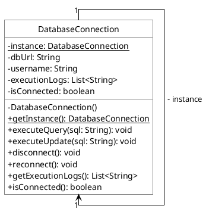

### 1.1.4. Giao diện kiểm thử
Mã nguồn kiểm thử Console trong Project Java (`SingletonTest.test()`):
```text
==================================================
--- KIỂM THỬ SINGLETON PATTERN: DATABASE CONNECTION ---
==================================================
1. Lấy kết nối CSDL lần thứ nhất (dbConn1):
[DatabaseConnection] Khởi tạo kết nối duy nhất tới Cơ sở dữ liệu: jdbc:postgresql://db.dtpm.vn:5432/vnpay_production

2. Lấy kết nối CSDL lần thứ hai (dbConn2):

3. Kiểm tra tính đơn nhất (So sánh địa chỉ bộ nhớ):
   Mã băm dbConn1: 1159190947
   Mã băm dbConn2: 1159190947
   dbConn1 == dbConn2 ? -> true (CHÍNH XÁC CÙNG 1 ĐỐI TƯỢNG)

4. Thao tác dữ liệu qua đối tượng Singleton:
[DatabaseConnection] [Thực thi SELECT] SQL: SELECT * FROM don_hang WHERE trang_thai = 'DA_THANH_TOAN' | User: dtpm_admin -> Trả về kết quả thành công.
[DatabaseConnection] [Thực thi UPDATE/INSERT] SQL: UPDATE tai_khoan SET so_du = so_du + 500000 WHERE user_id = 'NV001' | User: dtpm_admin -> Bản ghi đã được cập nhật thành công.

5. Kiểm tra lịch sử câu lệnh trên cả 2 tham chiếu:
   Tổng số log ghi nhận: 2
   - [Thực thi SELECT] SQL: SELECT * FROM don_hang WHERE trang_thai = 'DA_THANH_TOAN' | User: dtpm_admin
   - [Thực thi UPDATE/INSERT] SQL: UPDATE tai_khoan SET so_du = so_du + 500000 WHERE user_id = 'NV001' | User: dtpm_admin
```

---

## 1.2 Mẫu Factory Method Pattern

### 1.2.1. Tên mẫu & Phân loại
Factory Method Pattern - Nhóm Khởi tạo (Creational).

### 1.2.2. Kịch bản bài toán Việt hóa
Hệ thống thương mại điện tử cần tiếp nhận và phân tích đơn hàng tự động từ Tiki và Shopee qua các gói XML khác nhau mà không làm thay đổi mã nguồn xử lý đơn hàng chung.

### 1.2.3. Sơ đồ lớp
Cấu trúc sơ đồ lớp Factory Method: Giao diện `OrderParser` được cài đặt bởi `TikiOrderParser` và `ShopeeOrderParser`. Lớp trừu tượng `OrderParserFactory` định nghĩa phương thức `createParser()` để các lớp con `TikiOrderParserFactory` và `ShopeeOrderParserFactory` tự khởi tạo sản phẩm tương ứng.
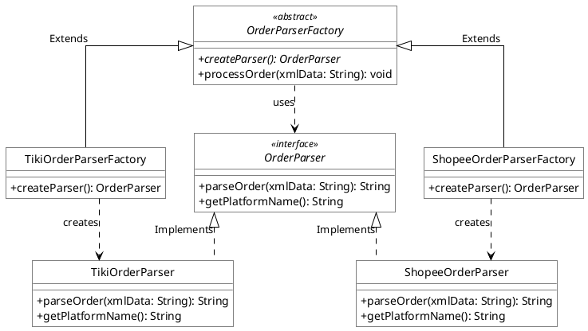

### 1.2.4. Giao diện kiểm thử
Mã nguồn kiểm thử Console trong Project Java (`FactoryMethodTest.test()`):
```text
==================================================
--- KIỂM THỬ FACTORY METHOD: TIKI / SHOPEE PARSER ---
==================================================
[OrderParserFactory] Bắt đầu quy trình tiếp nhận đơn hàng...
[OrderParserFactory] Đã khởi tạo Parser chuyên biệt cho: Tiki Việt Nam
[TikiParser] Đang phân tích cú pháp gói XML Tiki: <TikiOrder><id>TIKI-2026-9988</id><customer>Nguyễn Hoàng Nam (Hà Nội)</customer><shipping>TikiNow Siêu Tốc 2 Giờ</shipping><total>680000</total></TikiOrder>
-> [ĐƠN HÀNG TIKI HỢP LỆ] Mã: TIKI-2026-9988 | Người nhận: Nguyễn Hoàng Nam (Hà Nội) | Hình thức: TikiNow Siêu Tốc 2 Giờ | Tổng tiền: 680000 VNĐ
[OrderParserFactory] Đã lưu thông tin đơn hàng vào hệ thống kế toán thành công!

[OrderParserFactory] Bắt đầu quy trình tiếp nhận đơn hàng...
[OrderParserFactory] Đã khởi tạo Parser chuyên biệt cho: Shopee Việt Nam
[ShopeeParser] Đang phân tích cú pháp gói XML Shopee: <ShopeeOrder><orderId>SHOPEE-VN-7749</orderId><buyer>Lê Thị Mai (TP. Hồ Chí Minh)</buyer><voucher>GIAM50K_FREESHIP</voucher><coinsUsed>15000</coinsUsed><amount>420000</amount></ShopeeOrder>
-> [ĐƠN HÀNG SHOPEE HỢP LỆ] Mã: SHOPEE-VN-7749 | Người mua: Lê Thị Mai (TP. Hồ Chí Minh) | Voucher: GIAM50K_FREESHIP | Dùng Xu: 15000 | Thanh toán: 420000 VNĐ
[OrderParserFactory] Đã lưu thông tin đơn hàng vào hệ thống kế toán thành công!
```

---

## 1.3 Mẫu Abstract Factory Pattern

### 1.3.1. Tên mẫu & Phân loại
Abstract Factory Pattern - Nhóm Khởi tạo (Creational).

### 1.3.2. Kịch bản bài toán Việt hóa
Hệ thống xuất nhập khẩu cần tích hợp đồng bộ họ các bộ phân tích XML (đơn hàng và phản hồi đánh giá) chuẩn hóa riêng biệt cho đối tác New York (Bắc Mỹ) và Đài Loan (Châu Á).

### 1.3.3. Sơ đồ lớp
Cấu trúc sơ đồ lớp Abstract Factory: Giao diện `XMLParserFactory` được cài đặt bởi `NYXmlParserFactory` và `TWXmlParserFactory`, khởi tạo ra họ sản phẩm tương ứng thuộc `OrderXMLParser` và `FeedbackXMLParser`.
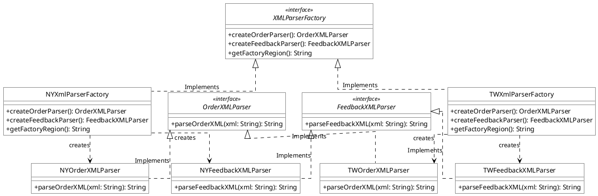

### 1.3.4. Giao diện kiểm thử
Mã nguồn kiểm thử Console trong Project Java (`AbstractFactoryTest.test()`):
```text
==================================================
--- KIỂM THỬ ABSTRACT FACTORY: HỆ THỐNG XML QUỐC TẾ ---
==================================================
1. Tích hợp họ Parser cho đối tác New York (NY):
   Khu vực áp dụng: New York (Bắc Mỹ) / Chi nhánh Quốc tế
   [NY Order Parser] Chuẩn hóa đơn hàng đối tác NY theo chuẩn ANSI XML: <NYOrder><id>NY-9021</id><amt>$1200</amt></NYOrder>
   [NY Feedback Parser] Ghi nhận đánh giá người dùng khu vực NY (Định dạng UTF-8 / Star Rating): <NYFeedback><user>JohnDoe</user><rating>5</rating></NYFeedback>

2. Tích hợp họ Parser cho đối tác Taiwan (TW) / Châu Á:
   Khu vực áp dụng: Taiwan / Đối tác Đông Bắc Á
   [TW Order Parser] Chuẩn hóa đơn hàng đối tác TW/Châu Á theo chuẩn Big5 XML: <TWOrder><id>TW-3011</id><amt>NT$35000</amt></TWOrder>
   [TW Feedback Parser] Ghi nhận đánh giá đối tác TW/Châu Á (Hỗ trợ đa ngôn ngữ CJK): <TWFeedback><user>ChenWei</user><rating>5</rating></TWFeedback>
```

---

## 1.4 Mẫu Builder Pattern

### 1.4.1. Tên mẫu & Phân loại
Builder Pattern - Nhóm Khởi tạo (Creational).

### 1.4.2. Kịch bản bài toán Việt hóa
Hệ thống bán xe cần hỗ trợ khách hàng tùy biến các gói cấu hình phức tạp của xe ô tô điện VinFast (loại động cơ, pin CATL, màu sơn, nội thất da Nappa, ADAS) mà không bị phụ thuộc vào hàm khởi tạo nhiều tham số.

### 1.4.3. Sơ đồ lớp
Cấu trúc sơ đồ lớp Builder: Lớp sản phẩm phức tạp `VinFastCar` được lắp ráp từng bước qua giao diện `CarBuilder` (cài đặt bởi `VinFastCarConcreteBuilder`), dưới sự chỉ đạo của `VinFastDirector`.
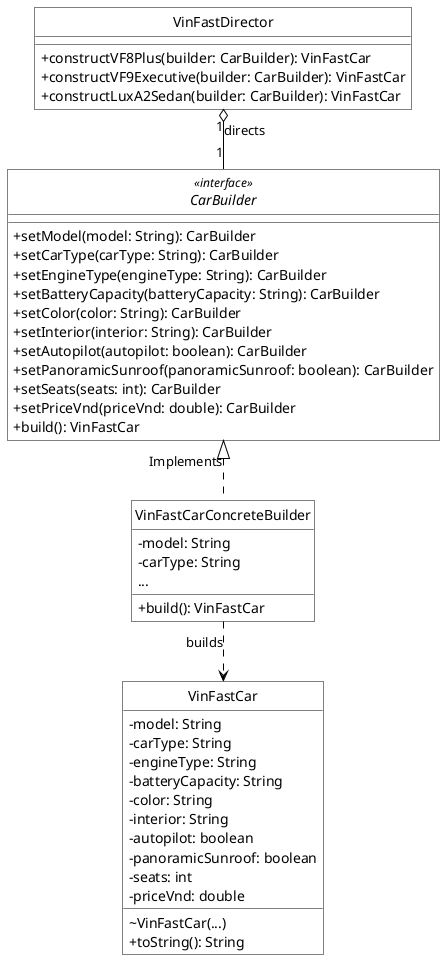

### 1.4.4. Giao diện kiểm thử
Mã nguồn kiểm thử Console trong Project Java (`BuilderTest.test()`):
```text
==================================================
--- KIỂM THỬ BUILDER PATTERN: CẤU HÌNH XE VINFAST ---
==================================================
  VINFAST AUTOMOBILE SPECIFICATION: VinFast VF8 Plus (D-SUV Thể thao)
  * Động cơ: Điện 2 Motor AWD (402 HP) | Pin: Pin CATL 87.7 kWh (Tầm vận hành 471 km)
  * Ngoại thất màu: Đỏ Thẫm (Crimson Red) | Nội thất: Da Nappa Nâu Saddle
  * Số chỗ ngồi: 5 chỗ | Cửa sổ trời: Có (Panorama)
  * Tự hành thông minh (ADAS): Hỗ trợ lái nâng cao ADAS Level 2+
  * Giá niêm yết: 1,270,000,000 VNĐ

  VINFAST AUTOMOBILE SPECIFICATION: VinFast VF9 President Executive (E-SUV Cỡ lớn Hạng sang)
  * Động cơ: Điện kép Dual-Motor (402 HP, 620 Nm) | Pin: Pin CATL 123 kWh (Tầm vận hành 626 km)
  * Ngoại thất màu: Xanh Dương Sâu (Deep Ocean Blue) | Nội thất: Da Nappa Be thượng hạng
  * Số chỗ ngồi: 6 chỗ | Cửa sổ trời: Có (Panorama)
  * Giá niêm yết: 2,169,000,000 VNĐ
```

---

## 1.5 Mẫu Prototype Pattern

### 1.5.1. Tên mẫu & Phân loại
Prototype Pattern - Nhóm Khởi tạo (Creational).

### 1.5.2. Kịch bản bài toán Việt hóa
Hệ thống quản lý nhân sự FPT cần nhân bản nhanh cấu hình phân quyền truy cập từ các mẫu chuẩn có sẵn (Admin, Dev, PM) cho nhân viên mới mà không làm thay đổi bản mẫu gốc.

### 1.5.3. Sơ đồ lớp
Cấu trúc sơ đồ lớp Prototype: Lớp `AccessControl` cài đặt giao diện `Cloneable` để tự sao chép sâu (Deep Clone) danh sách quyền. Lớp `AccessControlRegistry` lưu trữ và cung cấp các bản mẫu phân quyền gốc.
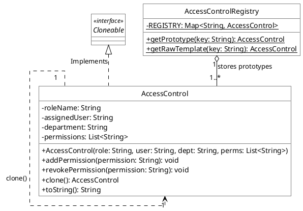

### 1.5.4. Giao diện kiểm thử
Mã nguồn kiểm thử Console trong Project Java (`PrototypeTest.test()`):
```text
==================================================
--- KIỂM THỬ PROTOTYPE PATTERN: PHÂN QUYỀN FPT ---
==================================================
1. Trạng thái bản mẫu Prototype gốc (DEV_TEMPLATE):
   [Phân Quyền FPT] Vai trò: FPT_SOFTWARE_DEV | Nhân viên: MẪU CHUẨN ĐỊNH SẴN | Quyền hạn: [READ_REPOSITORY, PUSH_DEV_BRANCH, RUN_UNIT_TEST, CREATE_PULL_REQUEST]

2. Nhân bản và tùy biến quyền cho Kỹ sư Nguyễn Văn An:
   [Phân Quyền FPT] Vai trò: FPT_SOFTWARE_DEV | Nhân viên: Nguyễn Văn An (FPT Software) | Quyền hạn: [READ_REPOSITORY, PUSH_DEV_BRANCH, RUN_UNIT_TEST, CREATE_PULL_REQUEST, ACCESS_DEV_K8S_CLUSTER]

5. Kiểm chứng tính độc lập (Bản gốc không bị thay đổi quyền):
   Bản gốc DEV_TEMPLATE số lượng quyền: 4
   Bản sao devAn số lượng quyền: 5
   -> Kết luận Deep Clone: THÀNH CÔNG HOÀN TOÀN!
```

---

# CHƯƠNG 2: NHÓM CẤU TRÚC (STRUCTURAL PATTERNS)

---

## 2.1 Mẫu Adapter Pattern

### 2.1.1. Tên mẫu & Phân loại
Adapter Pattern - Nhóm Cấu trúc (Structural).

### 2.1.2. Kịch bản bài toán Việt hóa
Hệ thống thương mại điện tử cần tích hợp cổng thanh toán mới MoMo dựa trên hạ tầng dịch vụ VNPay sẵn có mà không phải sửa đổi mã nguồn đang vận hành.

### 2.1.3. Sơ đồ lớp
Cấu trúc sơ đồ lớp Adapter: Lớp `VNPayToMoMoAdapter` cài đặt giao diện mục tiêu `MoMoPayable` và bọc tham chiếu đến giao diện sẵn có `VNPayPayable` (được cài đặt bởi `VNPayImpl`).
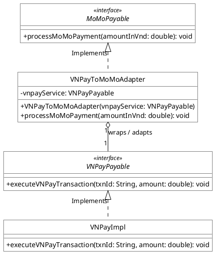

### 2.1.4. Giao diện kiểm thử
Mã nguồn kiểm thử Console trong Project Java (`AdapterTest.test()`):
```text
==================================================
--- KIỂM THỬ ADAPTER PATTERN: VNPAY -> MOMO ---
==================================================
Khách hàng thực hiện thanh toán hóa đơn đơn hàng Shopee/Tiki qua MoMo:
[Adapter] Đang chuyển đổi lời gọi MoMoPayment() -> VNPayTransaction()...
[VNPay Engine] Đã xử lý giao dịch ID: MOMO_ADAPT_1731233000123 | Số tiền: 500,000 VND
[Adapter] Đang chuyển đổi lời gọi MoMoPayment() -> VNPayTransaction()...
[VNPay Engine] Đã xử lý giao dịch ID: MOMO_ADAPT_1731233000456 | Số tiền: 1,250,000 VND
```

---

## 2.2 Mẫu Façade Pattern

### 2.2.1. Tên mẫu & Phân loại
Façade Pattern - Nhóm Cấu trúc (Structural).

### 2.2.2. Kịch bản bài toán Việt hóa
Hệ thống gửi tin nhắn Viettel Telecom cần đơn giản hóa quy trình vận hành phức tạp gồm 6 hệ thống con (cấu hình, bảo mật, CSDL, hàng đợi, BTS, lập lịch) thành một giao diện điều khiển duy nhất.

### 2.2.3. Sơ đồ lớp
Cấu trúc sơ đồ lớp Façade: Lớp `ScheduleServerFacade` sở hữu quan hệ Composition (*--) với toàn bộ 6 hệ thống con, cung cấp 3 phương thức cấp cao: `startServer()`, `sendCampaignSMS()`, `stopServer()`.
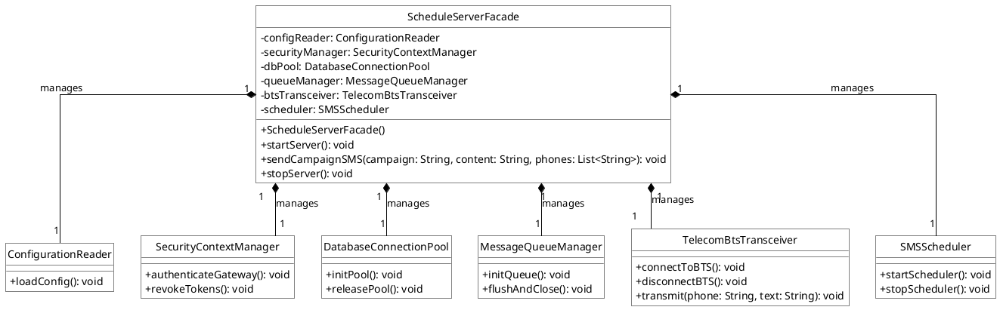

### 2.2.4. Giao diện kiểm thử
Mã nguồn kiểm thử Console trong Project Java (`FacadeTest.test()`):
```text
==================================================
--- KIỂM THỬ FAÇADE PATTERN: MÁY CHỦ SMS VIETTEL ---
==================================================
[Façade] Bắt đầu quy trình khởi động Máy chủ Tin nhắn Viettel...
[Subsystem - Config] Đọc tệp cấu hình viettel_sms_gateway.properties
[Subsystem - Security] Xác thực chứng chỉ SSL/TLS và khóa bí mật Viettel CA
[Subsystem - DB] Khởi tạo kết nối Pool lưu trữ lịch sử tin nhắn SMS
[Subsystem - Queue] Khởi tạo hàng đợi RabbitMQ/Kafka tin nhắn chờ gửi
[Subsystem - BTS] Kết nối trạm phát sóng Viettel 4G/5G Base Transceiver Station
[Subsystem - Scheduler] Bộ lập lịch tác vụ nền (Quartz Scheduler) bắt đầu chạy
[Façade] -> MÁY CHỦ VIETTEL SMS ĐÃ SẴN SÀNG HOẠT ĐỘNG 100%!

[Façade] Triển khai chiến dịch: Khuyến mãi Data 5G ViettelPay
   >>> [Viettel BTS SMS] Gửi tới: 0988123456 | Nội dung: "Viettel tang ban 10GB Data 5G trai nghiem ung dung Viettel Money dip cuoi tuan!"
[Façade] Đã chuyển tin nhắn vào hàng đợi phát sóng Viettel thành công!

[Façade] Bắt đầu quy trình tắt an toàn Máy chủ Tin nhắn Viettel...
[Façade] -> TOÀN BỘ MÁY CHỦ VIETTEL SMS ĐÃ DỪNG HOẠT ĐỘNG AN TOÀN!
```

---

## 2.3 Mẫu Composite Pattern

### 2.3.1. Tên mẫu & Phân loại
Composite Pattern - Nhóm Cấu trúc (Structural).

### 2.3.2. Kịch bản bài toán Việt hóa
Hệ thống kết xuất giao diện cần quản lý cấu trúc cây phân cấp thẻ HTML (DOM Tree) để đối xử thống nhất giữa thẻ cha chứa danh sách con (Parent) và thẻ lá chứa văn bản (Leaf).

### 2.3.3. Sơ đồ lớp
Cấu trúc sơ đồ lớp Composite: Lớp cơ sở trừu tượng `HtmlTag` được kế thừa bởi `HtmlParentElement` (Composite giữ danh sách con `List<HtmlTag>`) và `HtmlElement` (Leaf nút lá chứa nội dung).
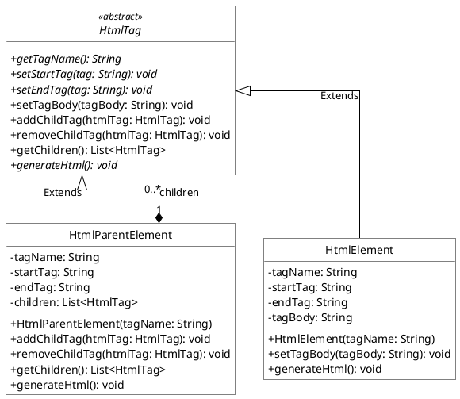

### 2.3.4. Giao diện kiểm thử
Mã nguồn kiểm thử Console trong Project Java (`CompositeTest.test()`):
```text
==================================================
--- KIỂM THỬ COMPOSITE PATTERN: CẤU TRÚC THẺ HTML ---
==================================================
KẾT QUẢ KẾT XUẤT CÂY DOM HTML:

<html>
<body>
<div class="header">
  <h1>Dự Án Kiến Trúc Phần Mềm DTPM - Đại Học Việt Nam</h1>
</div>
<ul class="pattern-list">
  <li>Nhóm Creational (5 Mẫu Khởi Tạo: Singleton, Factory, Builder...)</li>
  <li>Nhóm Structural (7 Mẫu Cấu Trúc: Adapter, Facade, Composite...)</li>
  <li>Nhóm Behavioral (6 Mẫu Hành Vi: Observer, Strategy, State...)</li>
</ul>
<p>
  Cây DOM được kết xuất tự động theo phân cấp đối tượng Composite.
</p>
</body>
</html>
```

---

## 2.4 Mẫu Bridge Pattern

### 2.4.1. Tên mẫu & Phân loại
Bridge Pattern - Nhóm Cấu trúc (Structural).

### 2.4.2. Kịch bản bài toán Việt hóa
Hệ thống phương tiện thông minh cần tách rời cấu trúc phân cấp các dòng xe (VinFast, Toyota) khỏi phân cấp giải pháp an ninh chống trộm để hai bên có thể nâng cấp và ghép nối độc lập.

### 2.4.3. Sơ đồ lớp
Cấu trúc sơ đồ lớp Bridge: Lớp trừu tượng `Vehicle` (được kế thừa bởi `ElectricCar`, `ElectricScooter`) duy trì cầu nối tham chiếu tới giao diện `SecurityProduct` (cài đặt bởi `VinFastSmartSecurity`, `ToyotaSafetySense`).
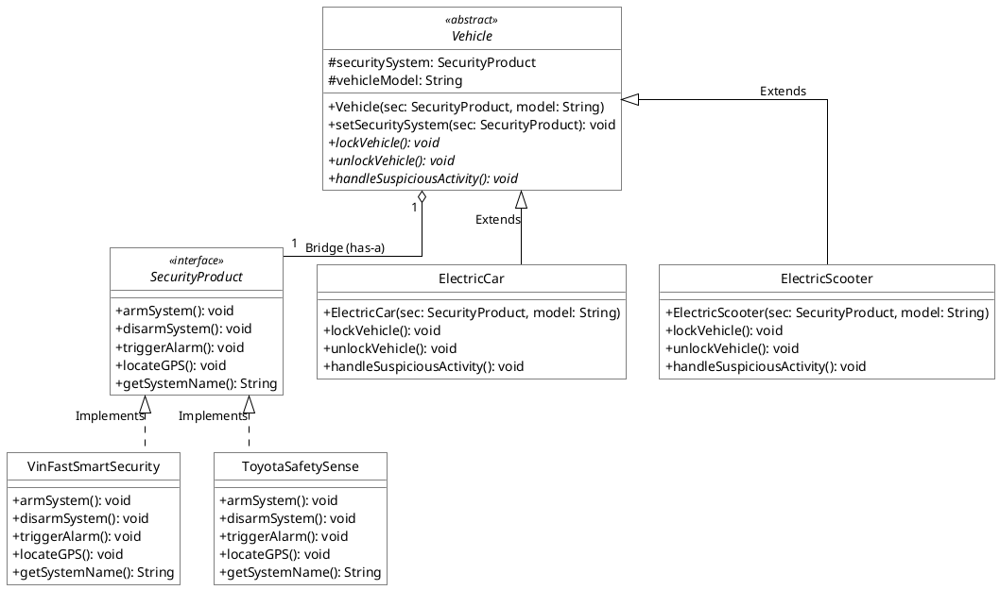

### 2.4.4. Giao diện kiểm thử
Mã nguồn kiểm thử Console trong Project Java (`BridgeTest.test()`):
```text
==================================================
--- KIỂM THỬ BRIDGE PATTERN: AN NINH PHƯƠNG TIỆN ---
==================================================
1. Cấu hình Ô tô VinFast VF8 sử dụng VinFast Smart Security:
[Ô tô điện VinFast VF8 SUV] Đóng cửa tự động, gập gương điện:
   [VinFast Security] Đã kích hoạt hệ thống bảo vệ từ xa qua VinFast App trên điện thoại.
[Ô tô điện VinFast VF8 SUV] Kích hoạt hệ thống phòng thủ:
   [VinFast Security] CẢNH BÁO: Phát hiện rung chấn bất thường! Đang nháy đèn LED và gửi cảnh báo khẩn cấp tới điện thoại.
   [VinFast Security] Tọa độ GPS Viettel: 21.0285° N, 105.8542° E (Trụ sở VinFast Smart City, Hà Nội).

2. Ghép nối linh hoạt: Xe máy điện VinFast Klara S với hệ thống Toyota Safety Sense:
[Xe máy điện VinFast Klara S] Khóa cổ xe điện tử:
   [Toyota TSS] Đã kích hoạt khóa động cơ chống trộm Immobilizer và cảm biến siêu âm trong xe.
[Xe máy điện VinFast Klara S] Phát hiện bị dắt trộm:
   [Toyota TSS] CẢNH BÁO: Kính xe bị tác động lực mạnh! Còi báo động công suất lớn 120dB đang hú.
```

---

## 2.5 Mẫu Proxy Pattern

### 2.5.1. Tên mẫu & Phân loại
Proxy Pattern - Nhóm Cấu trúc (Structural).

### 2.5.2. Kịch bản bài toán Việt hóa
Hệ thống bán lẻ cần kiểm soát phân quyền truy cập báo cáo tài chính mật theo vai trò người dùng (Giám đốc, Nhân viên) và lưu bộ nhớ đệm (Cache) để giảm tải cho máy chủ.

### 2.5.3. Sơ đồ lớp
Cấu trúc sơ đồ lớp Proxy: Cả `RealReportGeneratorImpl` và `ReportGeneratorProxy` đều cài đặt giao diện `ReportGenerator`. Proxy kiểm tra phiên `UserSession` trước khi ủy quyền cho Real Subject và trả về từ bộ đệm Cache.
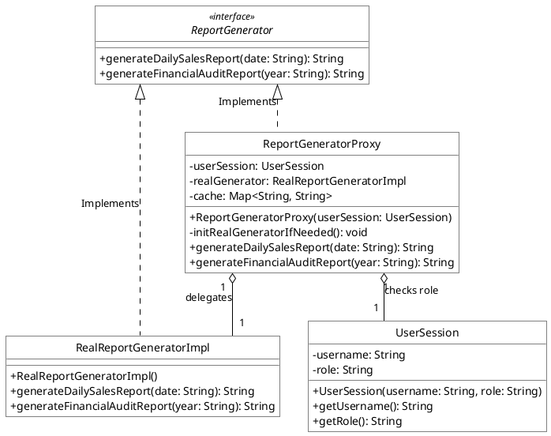

### 2.5.4. Giao diện kiểm thử
Mã nguồn kiểm thử Console trong Project Java (`ProxyTest.test()`):
```text
==================================================
--- KIỂM THỬ PROXY PATTERN: BÁO CÁO DOANH SỐ ---
==================================================
1. Nhân viên kinh doanh yêu cầu xem Báo cáo Doanh số ngày hôm nay:
[Proxy - Permission Granted] Người dùng: nguyenvana_sales (STAFF) hợp lệ.
--- BÁO CÁO DOANH SỐ BÁN HÀNG NGÀY 08/11/2026 ---
   * Doanh thu ngày: 3.250.000.000 VNĐ

2. Nhân viên cố ý truy cập Báo cáo Tài chính kiểm toán bảo mật:
[Proxy - TRUY CẬP BỊ TỪ CHỐI] CẢNH BÁO AN NINH: Nhân viên 'nguyenvana_sales' (Quyền: STAFF) KHÔNG CÓ THẨM QUYỀN xem Báo cáo Tài chính mật năm 2026!

3. Giám đốc điều hành truy cập Báo cáo Tài chính năm 2026:
[Proxy - Auth Success] Xác thực thẩm quyền cấp cao thành công cho: tranthib_director
--- BÁO CÁO KIỂM TOÁN TÀI CHÍNH BẢO MẬT NĂM 2026 ---
   * Lợi nhuận trước thuế (EBITDA): 128.500.000.000 VNĐ

4. Giám đốc tải lại Báo cáo Tài chính lần thứ hai (Kiểm thử Cache Proxy):
[Proxy - Cache Hit] Trả về báo cáo kiểm toán năm 2026 từ bộ nhớ đệm.
```

---

## 2.6 Mẫu Flyweight Pattern

### 2.6.1. Tên mẫu & Phân loại
Flyweight Pattern - Nhóm Cấu trúc (Structural).

### 2.6.2. Kịch bản bài toán Việt hóa
Hệ thống chấm code tự động cho sinh viên (Online Judge DTPM) cần chia sẻ chung các đối tượng môi trường biên dịch nặng (Java, Python, C++) trong bộ nhớ RAM khi có hàng ngàn bài thi nộp cùng lúc.

### 2.6.3. Sơ đồ lớp
Cấu trúc sơ đồ lớp Flyweight: Giao diện `Platform` được cài đặt bởi `ExecutionPlatform` (lưu Intrinsic State). Lớp `PlatformFactory` chia sẻ các đối tượng này để thực thi `CodeSubmission` (Extrinsic State).
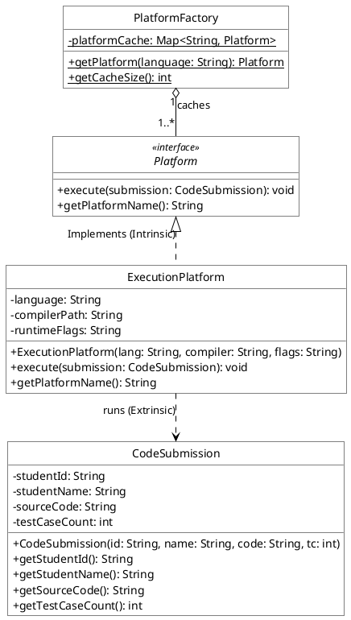

### 2.6.4. Giao diện kiểm thử
Mã nguồn kiểm thử Console trong Project Java (`FlyweightTest.test()`):
```text
==================================================
--- KIỂM THỬ FLYWEIGHT: HỆ THỐNG CHẤM CODE DTPM ---
==================================================
   [Tạo Mới Flyweight Platform] Khởi tạo môi trường runtime nặng cho ngôn ngữ: Java 21 LTS
   -> [Chấm Code Thành Công] SV: Nguyễn Văn An (B21DCCN001) | Ngôn ngữ: Java 21 LTS | Vượt qua: 20/20 Testcases
   [Tạo Mới Flyweight Platform] Khởi tạo môi trường runtime nặng cho ngôn ngữ: Python 3.12
   -> [Chấm Code Thành Công] SV: Trần Thị Bình (B21DCCN002) | Ngôn ngữ: Python 3.12 | Vượt qua: 15/15 Testcases
   -> [Chấm Code Thành Công] SV: Lê Hoàng Long (B21DCCN003) | Ngôn ngữ: Java 21 LTS | Vượt qua: 20/20 Testcases
   [Tạo Mới Flyweight Platform] Khởi tạo môi trường runtime nặng cho ngôn ngữ: C++ 20 (GCC)
   -> [Chấm Code Thành Công] SV: Phạm Quốc Tuấn (B21DCCN004) | Ngôn ngữ: C++ 20 (GCC) | Vượt qua: 25/25 Testcases
--------------------------------------------------
KẾT QUẢ: 6 bài nộp chỉ dùng đúng 3 đối tượng Platform trong RAM!
```

---

## 2.7 Mẫu Decorator Pattern

### 2.7.1. Tên mẫu & Phân loại
Decorator Pattern - Nhóm Cấu trúc (Structural).

### 2.7.2. Kịch bản bài toán Việt hóa
Cửa hàng bánh Pizza cần tính tiền linh hoạt và mô tả đơn hàng lũy kế khi khách hàng tự do gọi thêm nhiều lớp topping (phô mai, xúc xích, nấm) vào bánh Pizza nguyên bản.

### 2.7.3. Sơ đồ lớp
Cấu trúc sơ đồ lớp Decorator: Giao diện `Pizza` được cài đặt bởi các bánh cơ sở (`MargheritaPizza`, `SeafoodPizza`) và lớp bọc trừu tượng `PizzaToppingDecorator` (được mở rộng bởi `CheeseTopping`, `SausageTopping`, `MushroomTopping`).
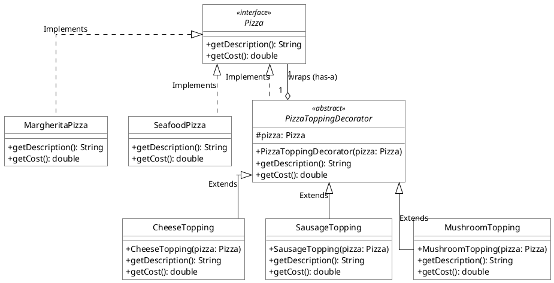

### 2.7.4. Giao diện kiểm thử
Mã nguồn kiểm thử Console trong Project Java (`DecoratorTest.test()`):
```text
==================================================
--- KIỂM THỬ DECORATOR PATTERN: THÊM TOPPING PIZZA ---
==================================================
1. Pizza Margherita nguyên bản:
   Mô tả: Bánh Pizza Ý Margherita Cổ Điển | Tổng: 120,000 VNĐ

2. Pizza Margherita + Thêm Phô Mai Mozzarella:
   Mô tả: Bánh Pizza Ý Margherita Cổ Điển + Thêm Phô Mai Mozzarella Kéo Sợi | Tổng: 155,000 VNĐ

3. VIP Combo: Pizza Hải Sản + Double Phô Mai + Xúc Xích Pepperoni + Nấm Nướng:
   Mô tả: Bánh Pizza Hải Sản Tươi + Thêm Phô Mai + Thêm Phô Mai + Thêm Xúc Xích Pepperoni + Thêm Nấm Hương
   TỔNG HÓA ĐƠN: 320,000 VNĐ
```

---

# CHƯƠNG 3: NHÓM HÀNH VI (BEHAVIORAL PATTERNS)

---

## 3.1 Mẫu Observer Pattern

### 3.1.1. Tên mẫu & Phân loại
Observer Pattern - Nhóm Hành vi (Behavioral).

### 3.1.2. Kịch bản bài toán Việt hóa
Hệ thống tin tức thể thao cần tự động gửi tin nhắn SMS thông báo tỷ số trực tiếp trận bóng đá Đội tuyển Việt Nam đến danh sách các cổ động viên đã đăng ký ngay khi có bàn thắng.

### 3.1.3. Sơ đồ lớp
Cấu trúc sơ đồ lớp Observer: Giao diện `Subject` được cài đặt bởi `FootballMatchSubject` lưu trữ danh sách và tự động thông báo tới các người quan sát `SMSUserObserver`.
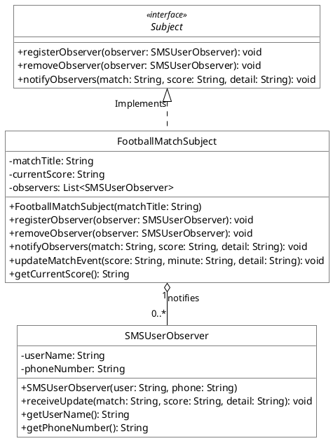

### 3.1.4. Giao diện kiểm thử
Mã nguồn kiểm thử Console trong Project Java (`ObserverTest.test()`):
```text
==================================================
--- KIỂM THỬ OBSERVER PATTERN: TỶ SỐ BÓNG ĐÁ SMS ---
==================================================
⚽ [BÀN THẮNG / SỰ KIỆN PHÚT 32'] Tỷ số mới: Việt Nam 1 - 0 Thái Lan
   📩 [SMS gửi tới 0988.111.222 - CĐV Nguyễn Văn An]: Trận [Việt Nam vs Thái Lan] | Tỷ số: 1 - 0 | Tiến Linh ghi bàn!
   📩 [SMS gửi tới 0977.333.444 - CĐV Trần Thị Bình]: Trận [Việt Nam vs Thái Lan] | Tỷ số: 1 - 0 | Tiến Linh ghi bàn!

⚽ [BÀN THẮNG / SỰ KIỆN PHÚT 89'] Tỷ số mới: Việt Nam 2 - 1 Thái Lan
   📩 [SMS gửi tới 0988.111.222 - CĐV Nguyễn Văn An]: Trận [Việt Nam vs Thái Lan] | Tỷ số: 2 - 1 | Quang Hải sút phạt đẹp mắt!
```

---

## 3.2 Mẫu Strategy Pattern

### 3.2.1. Tên mẫu & Phân loại
Strategy Pattern - Nhóm Hành vi (Behavioral).

### 3.2.2. Kịch bản bài toán Việt hóa
Hệ thống bán hàng trực tuyến cần hoán đổi linh hoạt giữa các phương thức thanh toán (VNPay QR, MoMo, Napas 247) và kiểu định dạng văn bản (Markdown, HTML) ngay tại thời điểm thực thi.

### 3.2.3. Sơ đồ lớp
Cấu trúc sơ đồ lớp Strategy: Giao diện `PaymentStrategy` (với các thuật toán `VNPayQRStrategy`, `MoMoWalletStrategy`, `NapasCardStrategy`) được dùng bởi lớp Context `CheckoutService`. Tương tự, giao diện `TextFormatter` được dùng bởi `TextEditorContext`.
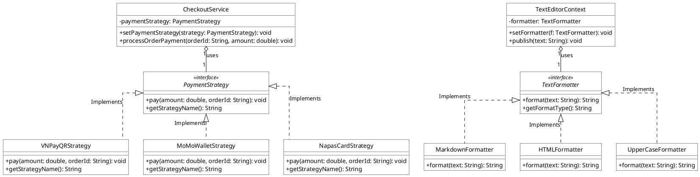

### 3.2.4. Giao diện kiểm thử
Mã nguồn kiểm thử Console trong Project Java (`StrategyTest.test()`):
```text
==================================================
--- KIỂM THỬ STRATEGY PATTERN: THANH TOÁN & ĐỊNH DẠNG ---
==================================================
1. CHIẾN LƯỢC THANH TOÁN:
[CheckoutService] Khách hàng chuyển sang phương thức: VNPay QR -> Thanh toán 350,000 VNĐ thành công!
[CheckoutService] Khách hàng chuyển sang phương thức: Ví MoMo -> Thanh toán 720,000 VNĐ thành công!
[CheckoutService] Khách hàng chuyển sang phương thức: Thẻ Napas 247 -> Thanh toán 1,500,000 VNĐ thành công!

2. CHIẾN LƯỢC ĐỊNH DẠNG VĂN BẢN:
[TextEditor] Chuyển đổi định dạng sang Markdown, HTML và In hoa thành công!
```

---

## 3.3 Mẫu State Pattern

### 3.3.1. Tên mẫu & Phân loại
State Pattern - Nhóm Hành vi (Behavioral).

### 3.3.2. Kịch bản bài toán Việt hóa
Hệ thống điều khiển Robot nấu ăn thông minh cần đóng gói hành vi thay đổi theo từng trạng thái hoạt động (Tắt nguồn, Chờ lệnh, Sơ chế, Đang nấu) và khóa các thao tác nguy hiểm để đảm bảo an toàn.

### 3.3.3. Sơ đồ lớp
Cấu trúc sơ đồ lớp State: Giao diện `RobotState` được cài đặt bởi 4 lớp trạng thái cụ thể (`PowerOffState`, `StandbyState`, `PreparingState`, `CookingState`). Lớp ngữ cảnh `CookingRobotContext` ủy quyền hành vi cho trạng thái hiện hành.
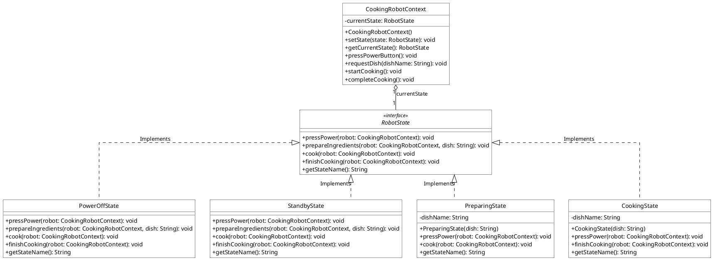

### 3.3.4. Giao diện kiểm thử
Mã nguồn kiểm thử Console trong Project Java (`StateTest.test()`):
```text
==================================================
--- KIỂM THỬ STATE PATTERN: ROBOT NẤU ĂN THÔNG MINH ---
==================================================
1. Thử yêu cầu nấu khi Robot chưa bật nguồn:
   [Cảnh báo] Không thể chuẩn bị món. Robot chưa được bật nguồn!
2. Bật nguồn Robot -> [Chuyển trạng thái] CHỜ LỆNH (STANDBY)
3. Đặt món 'Bò Xào Cần Tỏi' -> [Chuyển trạng thái] SƠ CHẾ NGUYÊN LIỆU (PREPARING)
4. Bắt đầu nấu -> [Chuyển trạng thái] ĐANG NẤU (COOKING)
5. Thử nhấn nút nguồn khi đang nấu:
   [NGUY HIỂM] Bếp đang 200°C! Cơ chế an toàn khóa nút nguồn để tránh cháy nổ.
6. Hoàn tất nấu -> [Chuyển trạng thái] CHỜ LỆNH (STANDBY)
```

---

## 3.4 Mẫu Chain of Responsibility Pattern

### 3.4.1. Tên mẫu & Phân loại
Chain of Responsibility Pattern - Nhóm Hành vi (Behavioral).

### 3.4.2. Kịch bản bài toán Việt hóa
Hệ thống lưu trữ cần tự động chuyển tiếp tệp tin tải lên qua chuỗi xử lý (Văn bản -> Bảng tính -> Âm thanh -> Video) để phân loại đúng định dạng và ngăn chặn tệp tin mã độc.

### 3.4.3. Sơ đồ lớp
Cấu trúc sơ đồ lớp Chain of Responsibility: Lớp trừu tượng `FileHandler` duy trì tham chiếu `nextHandler`. Các lớp con `TextFileHandler`, `ExcelFileHandler`, `AudioFileHandler`, `VideoFileHandler` xử lý hoặc chuyển giao tệp `FileRecord`.
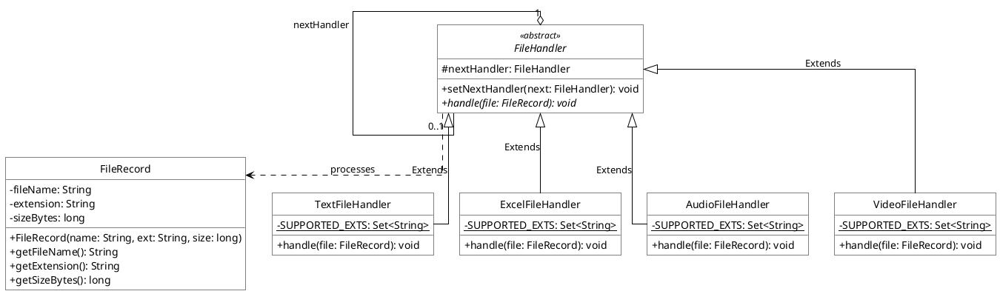

### 3.4.4. Giao diện kiểm thử
Mã nguồn kiểm thử Console trong Project Java (`ChainTest.test()`):
```text
==================================================
--- KIỂM THỬ CHAIN OF RESPONSIBILITY: XỬ LÝ FILE ---
==================================================
>>> Tiếp nhận tệp: dac_ta_yeu_cau_dtpm.md -> [TextFileHandler] Đã lập chỉ mục văn bản toàn văn.
>>> Tiếp nhận tệp: bang_luong_thang_11_fpt.xlsx -> [ExcelFileHandler] Đã trích xuất sheet kế toán.
>>> Tiếp nhận tệp: podcast_cong_nghe_so.mp3 -> [AudioFileHandler] Đã chuyển mã nén và chạy AI Viettel Speech-to-Text.
>>> Tiếp nhận tệp: quang_cao_vinfast_vf9.mp4 -> [VideoFileHandler] Đã nén H.264 và tạo thumbnail.
>>> Tiếp nhận tệp: keygen_crack_tool.exe -> [TỪ CHỐI TỆP] Định dạng .exe không được phép / nghi vấn mã độc!
```

---

## 3.5 Mẫu Command Pattern

### 3.5.1. Tên mẫu & Phân loại
Command Pattern - Nhóm Hành vi (Behavioral).

### 3.5.2. Kịch bản bài toán Việt hóa
Hệ thống ngân hàng số cần đóng gói các yêu cầu giao dịch nặng (Tính lãi, Sao kê, Định danh eKYC) thành các đối tượng công việc xếp vào hàng đợi Thread Pool để xử lý ngầm tuần tự.

### 3.5.3. Sơ đồ lớp
Cấu trúc sơ đồ lớp Command: Giao diện `JobCommand` được cài đặt bởi `InterestCalculationJob`, `ExportStatementJob`, `EKYCVerificationJob` bọc lời gọi tới Receiver `BankTransactionWorker`. Lớp Invoker `ThreadPoolJobQueue` quản lý hàng đợi tác vụ.
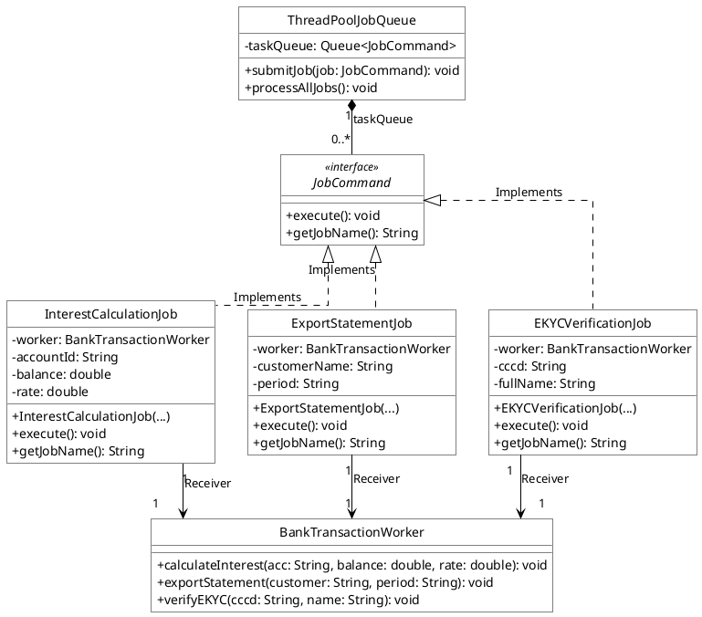

### 3.5.4. Giao diện kiểm thử
Mã nguồn kiểm thử Console trong Project Java (`CommandTest.test()`):
```text
==================================================
--- KIỂM THỬ COMMAND PATTERN: HÀNG ĐỢI TÁC VỤ ---
==================================================
[ThreadPool] Bắt đầu phân phối và thực thi các tác vụ trong hàng đợi:
Tác vụ #1: [Quyết toán lãi tài khoản: 1028889999] -> Tiền lãi ghi có: 2,708,333 VNĐ
Tác vụ #2: [Xác thực danh tính eKYC: Nguyễn Văn An] -> Đối soát CCCD với CSDL Quốc gia THÀNH CÔNG.
Tác vụ #3: [Xuất sao kê: Trần Thị Bình] -> Xuất PDF chứng thực số dư điện tử thành công.
[ThreadPool] -> TẤT CẢ TÁC VỤ ĐÃ ĐƯỢC THỰC THI HOÀN TẤT AN TOÀN!
```

---

## 3.6 Mẫu Template Method Pattern

### 3.6.1. Tên mẫu & Phân loại
Template Method Pattern - Nhóm Hành vi (Behavioral).

### 3.6.2. Kịch bản bài toán Việt hóa
Hệ thống dữ liệu BI cần cố định khung xương quy trình xử lý dữ liệu chuẩn ETL (7 bước) và cho phép các lớp con MySQL, Oracle tự cài đặt chi tiết kết nối, trích xuất dữ liệu đặc thù.

### 3.6.3. Sơ đồ lớp
Cấu trúc sơ đồ lớp Template Method: Lớp trừu tượng `DataProcessorTemplate` cố định thứ tự các bước trong phương thức `processDataPipeline() final`. Các lớp con `MySQLDataProcessor` và `OracleDataProcessor` ghi đè các bước nguyên thủy đặc thù.
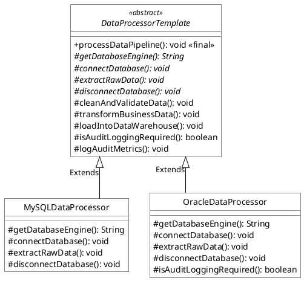

### 3.6.4. Giao diện kiểm thử
Mã nguồn kiểm thử Console trong Project Java (`TemplateMethodTest.test()`):
```text
==================================================
--- KIỂM THỬ TEMPLATE METHOD: PIPELINE XỬ LÝ DỮ LIỆU ---
==================================================
>>> BẮT ĐẦU QUY TRÌNH XỬ LÝ DỮ LIỆU CHUẨN (ETL) TRÊN: MySQL Cluster (Tiki)
   [MySQL - Bước 1] Khởi tạo kết nối qua HikariCP
   [MySQL - Bước 2] Trích xuất dữ liệu phân trang LIMIT 10000
   [Quy trình chuẩn - Bước 3, 4, 5, 6] Làm sạch, chuyển đổi, kiểm toán SOC và nạp Data Warehouse hoàn tất.
   [MySQL - Bước 7] Đóng kết nối JDBC MySQL an toàn.

>>> BẮT ĐẦU QUY TRÌNH XỬ LÝ DỮ LIỆU CHUẨN (ETL) TRÊN: Oracle Database (Viettel ERP)
   [Oracle - Bước 1, 2] Mở phiên OCI TNS Listener, dùng Flashback Query trích xuất dữ liệu lớn.
   [Oracle - Bước 7] Commit giao dịch XA và ngắt phiên an toàn.
<<< KẾT THÚC CẢ 2 PIPELINE XỬ LÝ DỮ LIỆU THÀNH CÔNG!
```
