# TỔNG HỢP SƠ ĐỒ LỚP (UML CLASS DIAGRAMS) CHUẨN KIẾN TRÚC CHO 18 DESIGN PATTERNS
> **Dự án:** 18 Mẫu Thiết Kế Hướng Đối Tượng - Đặc Tả Phần Mềm (DTPM)  
> **Ngôn ngữ:** Java SE 21 | **Chuẩn thiết kế:** GoF (Gang of Four) & UML 2.5 Tiêu Chuẩn  
> **Quy tắc vàng:** Chỉ biểu diễn các thành phần kiến trúc cốt lõi của Pattern, **LOẠI BỎ TOÀN BỘ CÁC LỚP TEST / CLIENT THỪA THÃI**.  
> **Định dạng trực quan:** Chuẩn Draw.io (Hộp chữ nhật 3 ngăn viền đen nền trắng, ký hiệu `+`, `-`, `#`, không icon tròn `(C)`, đường nối thẳng vuông góc 90°).

---

## 🎨 CẤU HÌNH ĐỒ HỌA TRỰC QUAN CHO DRAW.IO (ÁP DỤNG ĐỒNG BỘ 18 MẪU)

Tất cả 18 sơ đồ dưới đây đều được cấu hình với các tham số tối ưu hóa hiển thị cho Draw.io:
```plantuml
hide circle                          ' Xóa bỏ hoàn toàn biểu tượng hình tròn (C) trên tên Class
skinparam classAttributeIconSize 0   ' Hiển thị trực tiếp ký tự +, -, # thay vì icon màu
skinparam monochrome true            ' Đưa về chuẩn đen trắng cổ điển, sắc nét
skinparam shadowing false            ' Tắt hiệu ứng đổ bóng mờ
skinparam linetype ortho             ' Đường nối vuông góc 90 độ (Orthogonal), không cong queo
skinparam roundcorner 0              ' Góc hộp vuông vức 100% chuẩn Draw.io
skinparam class {
    BackgroundColor White
    ArrowColor Black
    BorderColor Black
}
```

---

## 🚀 HƯỚNG DẪN IMPORT VÀO DRAW.IO (3 BƯỚC)

1. Mở trang [draw.io](https://app.diagrams.net/).
2. Chọn menu: **Sắp xếp (Arrange)** ➔ **Chèn (Insert)** ➔ **Nâng cao (Advanced)** ➔ **PlantUML...**
3. **Copy toàn bộ khối mã `@startuml ... @enduml`** của mẫu cần vẽ, dán vào khung và nhấn **Chèn (Insert)**.

---

# PHẦN 1: NHÓM KHỞI TẠO (CREATIONAL PATTERNS) - 5 MẪU

---

### MẪU 1: SINGLETON PATTERN (Quản lý kết nối CSDL duy nhất)
* **Bản chất kiến trúc:** Chỉ có **DUY NHẤT 1 HỘP LỚP** đại diện cho đối tượng Singleton với phương thức khởi tạo riêng tư `private DatabaseConnection()` và thuộc tính tĩnh `- instance` tự trỏ về chính nó.

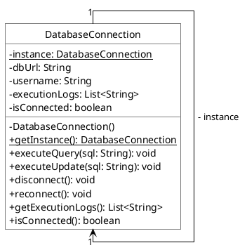

---

### MẪU 2: FACTORY METHOD PATTERN (Phân tích đơn hàng Tiki / Shopee XML)
* **Bản chất kiến trúc:** Phân tách rõ rệt giữa cấu trúc phân cấp Sản phẩm (`OrderParser`) và phân cấp Khởi tạo (`OrderParserFactory`).

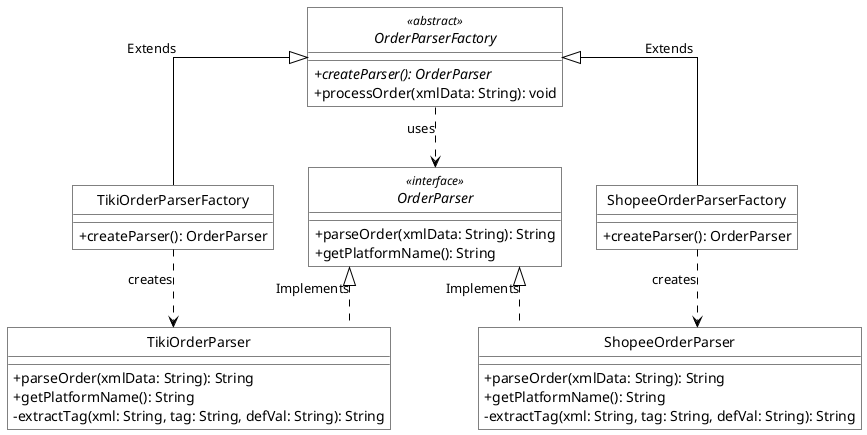

---

### MẪU 3: ABSTRACT FACTORY PATTERN (Bộ phân tích XML Khách hàng NY / TW)
* **Bản chất kiến trúc:** Cung cấp giao diện `XMLParserFactory` để khởi tạo họ các bộ phân tích (`OrderXMLParser` và `FeedbackXMLParser`) tương ứng cho từng đối tác.

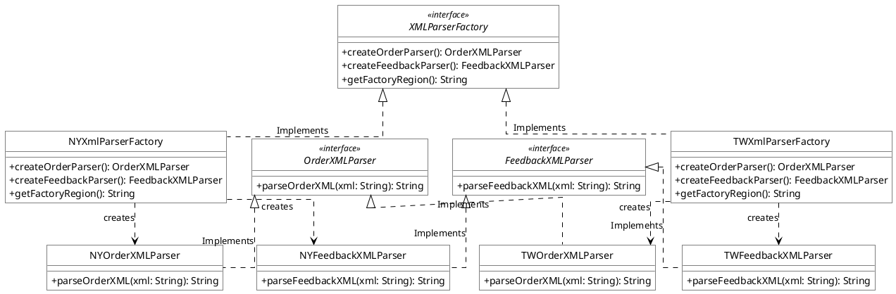

---

### MẪU 4: BUILDER PATTERN (Cấu hình xe VinFast)
* **Bản chất kiến trúc:** Tách rời cấu trúc sản phẩm phức tạp `VinFastCar` khỏi quy trình lắp ráp `CarBuilder`, dưới sự điều phối của `VinFastDirector`.

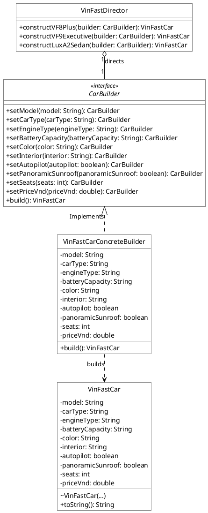

---

### MẪU 5: PROTOTYPE PATTERN (Nhân bản phân quyền FPT)
* **Bản chất kiến trúc:** Đối tượng `AccessControl` cài đặt giao diện `Cloneable` để tự nhân bản thông qua phương thức `clone()`, được quản lý tập trung bởi `AccessControlRegistry`.

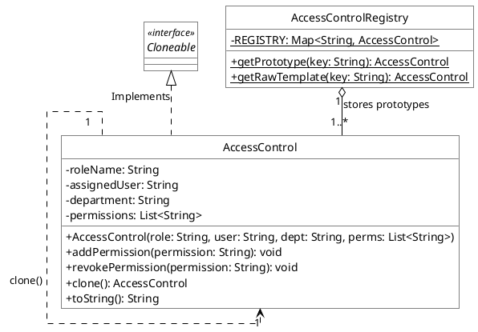

---

# PHẦN 2: NHÓM CẤU TRÚC (STRUCTURAL PATTERNS) - 7 MẪU

---

### MẪU 6: ADAPTER PATTERN (Chuyển đổi cổng thanh toán VNPay ➔ MoMo)
* **Bản chất kiến trúc:** Lớp `VNPayToMoMoAdapter` cài đặt giao diện mục tiêu `MoMoPayable` và bọc tham chiếu đến đối tượng thực thi `VNPayPayable`.

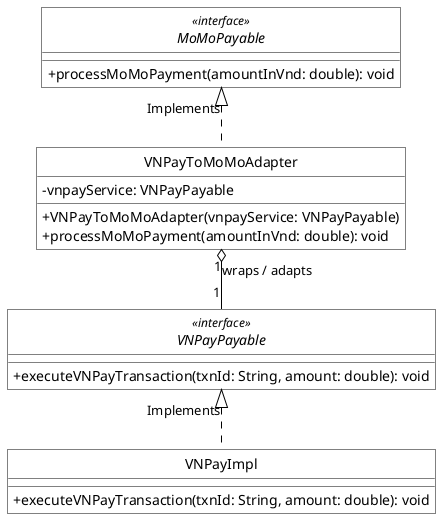

---

### MẪU 7: FAÇADE PATTERN (Máy chủ gửi tin nhắn Viettel)
* **Bản chất kiến trúc:** `ScheduleServerFacade` sở hữu quan hệ Composition (`*--`) trực tiếp với 6 hệ thống con để thống nhất một giao diện điều khiển đơn giản.

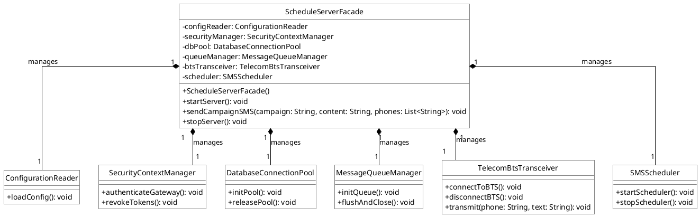

---

### MẪU 8: COMPOSITE PATTERN (Cấu trúc phân cấp thẻ HTML / DOM)
* **Bản chất kiến trúc:** `HtmlParentElement` (Composite) và `HtmlElement` (Leaf) đều kế thừa lớp cơ sở `HtmlTag`. Phần tử cha giữ danh sách các `HtmlTag` con.

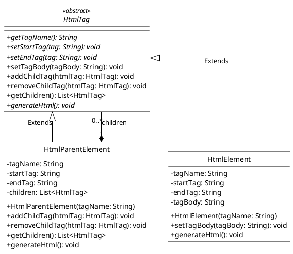

---

### MẪU 9: BRIDGE PATTERN (Hệ thống an ninh xe hơi VinFast / Toyota)
* **Bản chất kiến trúc:** Phân cấp Phương tiện `Vehicle` duy trì cầu nối tham chiếu tới phân cấp Hệ thống an ninh `SecurityProduct`.

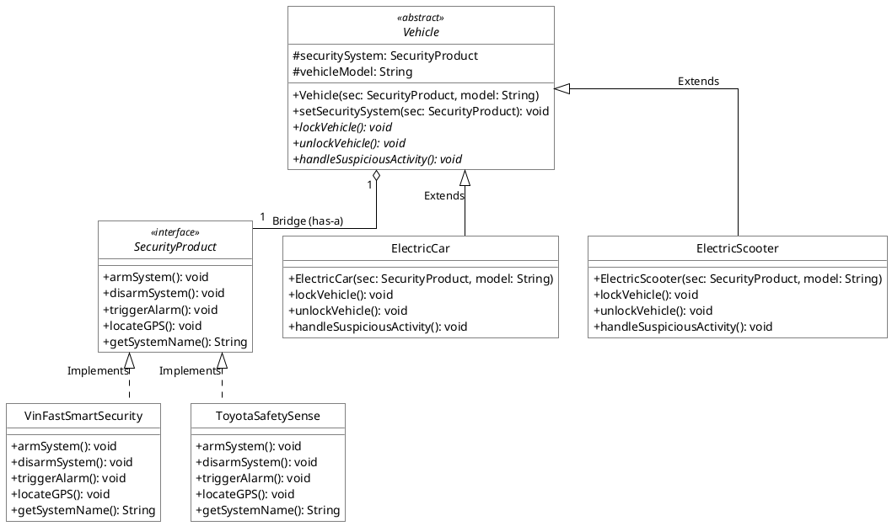

---

### MẪU 10: PROXY PATTERN (Kiểm soát truy cập báo cáo doanh số)
* **Bản chất kiến trúc:** Cả `RealReportGeneratorImpl` và `ReportGeneratorProxy` đều cài đặt giao diện `ReportGenerator`. Proxy bọc Real Subject và kiểm tra vai trò qua `UserSession`.

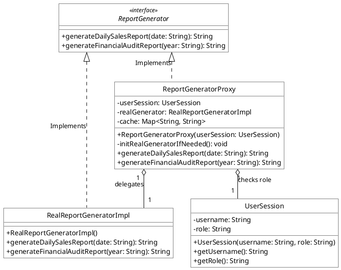

---

### MẪU 11: FLYWEIGHT PATTERN (Bộ tối ưu bộ nhớ chấm code online DTPM)
* **Bản chất kiến trúc:** `PlatformFactory` quản lý bộ nhớ đệm các đối tượng Flyweight `ExecutionPlatform` (trạng thái nội tại Intrinsic), tái sử dụng khi nhận bài nộp `CodeSubmission` (trạng thái ngoại lai Extrinsic).

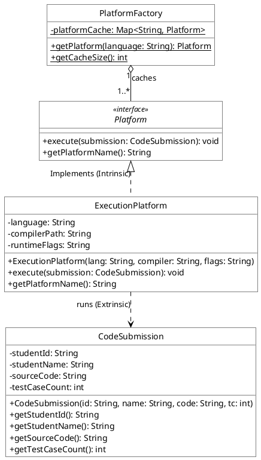

---

### MẪU 12: DECORATOR PATTERN (Thêm topping cho bánh Pizza)
* **Bản chất kiến trúc:** Lớp trang trí trừu tượng `PizzaToppingDecorator` vừa cài đặt giao diện `Pizza`, vừa bọc đối tượng `Pizza` bên trong để mở rộng tính năng động.

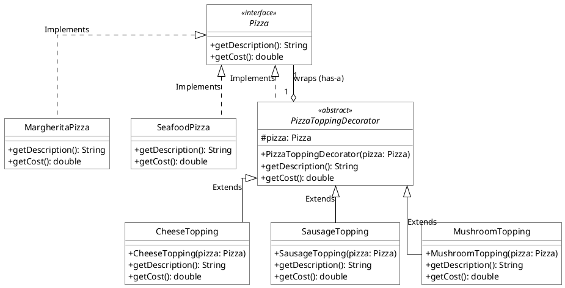

---

# PHẦN 3: NHÓM HÀNH VI (BEHAVIORAL PATTERNS) - 6 MẪU

---

### MẪU 13: OBSERVER PATTERN (Bắn SMS tỷ số bóng đá ĐTVN)
* **Bản chất kiến trúc:** Quan hệ Một - Nhiều (1-N). Khi trạng thái trận đấu trong `FootballMatchSubject` thay đổi, nó tự động thông báo tới danh sách các `SMSUserObserver`.

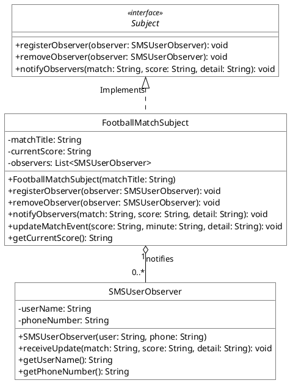

---

### MẪU 14: STRATEGY PATTERN (Chiến lược thanh toán & định dạng văn bản)
* **Bản chất kiến trúc:** Lớp Context (`CheckoutService` và `TextEditorContext`) giữ tham chiếu đến giao diện Strategy để hoán đổi thuật toán lúc chạy mà không sửa mã nguồn lớp gọi.

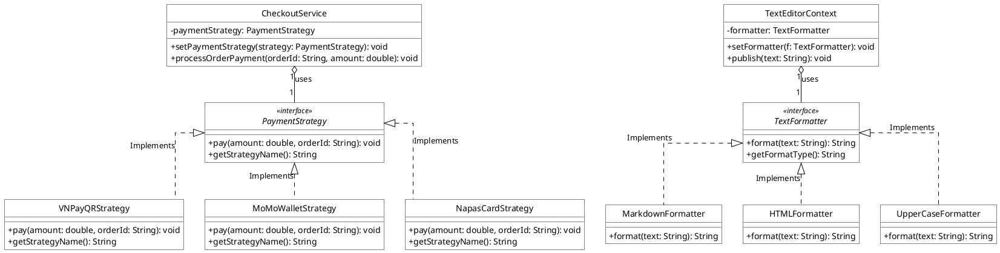

---

### MẪU 15: STATE PATTERN (Robot nấu ăn thông minh)
* **Bản chất kiến trúc:** `CookingRobotContext` ủy quyền mọi hành vi chuyển đổi cho đối tượng `RobotState` hiện hành.

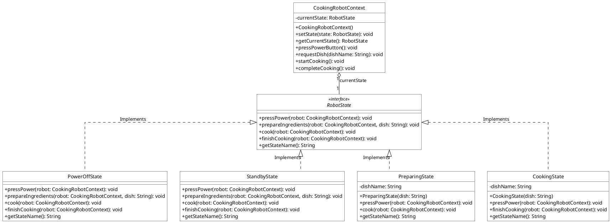

---

### MẪU 16: CHAIN OF RESPONSIBILITY PATTERN (Chuỗi phân loại tệp tin)
* **Bản chất kiến trúc:** Mỗi đối tượng `FileHandler` giữ một liên kết tự tham chiếu (`nextHandler`) trỏ đến mắt xích kế tiếp trong chuỗi trách nhiệm.

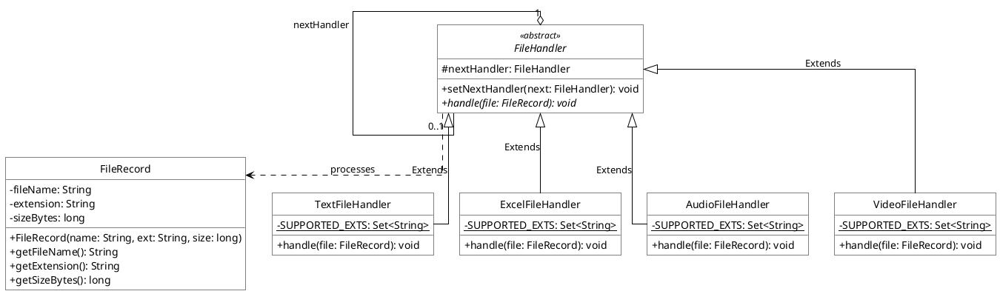

---

### MẪU 17: COMMAND PATTERN (Hàng đợi công việc Thread Pool)
* **Bản chất kiến trúc:** Tách rời hoàn toàn đối tượng gọi lệnh `ThreadPoolJobQueue` (Invoker) khỏi đối tượng thực thi `BankTransactionWorker` (Receiver) thông qua giao diện `JobCommand`.

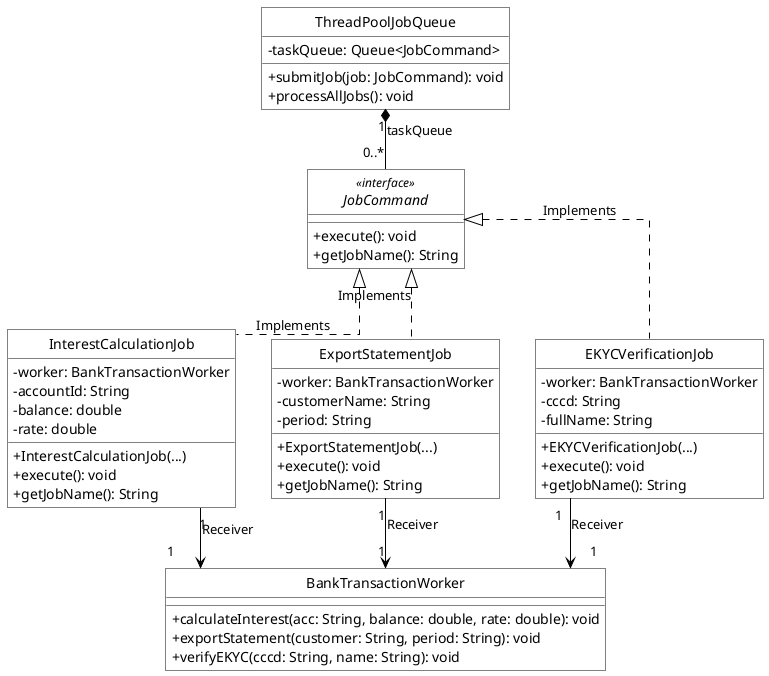

---

### MẪU 18: TEMPLATE METHOD PATTERN (Quy trình xử lý dữ liệu chuẩn ETL)
* **Bản chất kiến trúc:** Lớp trừu tượng `DataProcessorTemplate` giữ phương thức mẫu `final processDataPipeline()`, các lớp con `MySQLDataProcessor` và `OracleDataProcessor` chỉ kế thừa và ghi đè các bước nguyên thủy trừu tượng.

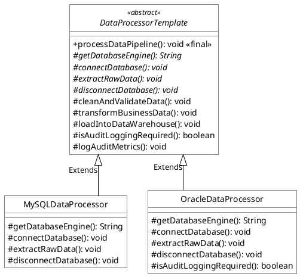

---

## 🏛️ BẢNG TỔNG KẾT KIẾN TRÚC 18 DESIGN PATTERNS CHUẨN GOF

| STT | Mẫu Thiết Kế | Phân Loại | Thành phần tham gia cốt lõi (Không lớp Test) | Mối quan hệ UML đặc trưng |
|:---:|---|:---:|---|---|
| **1** | **Singleton** | Creational | `DatabaseConnection` | `1 --> 1` (Self-Association duy nhất trỏ chính nó qua `- instance`). |
| **2** | **Factory Method** | Creational | `OrderParser`, `OrderParserFactory` (và các lớp con) | `<|--` (extends), `<|..` (implements), `..>` (creates). |
| **3** | **Abstract Factory** | Creational | `XMLParserFactory`, `OrderXMLParser`, `FeedbackXMLParser` | Tạo họ 2 loại sản phẩm parser cho NY và TW. |
| **4** | **Builder** | Creational | `VinFastCar`, `CarBuilder`, `VinFastDirector` | `VinFastDirector o--> CarBuilder ..> VinFastCar`. |
| **5** | **Prototype** | Creational | `AccessControl`, `Cloneable`, `AccessControlRegistry` | `AccessControlRegistry o--> AccessControl` (Deep Clone). |
| **6** | **Adapter** | Structural | `MoMoPayable`, `VNPayPayable`, `VNPayToMoMoAdapter` | `VNPayToMoMoAdapter o--> VNPayPayable` (wraps / adapts). |
| **7** | **Façade** | Structural | `ScheduleServerFacade`, 6 lớp hệ thống con | `ScheduleServerFacade *-- Subsystems` (Composition sống còn). |
| **8** | **Composite** | Structural | `HtmlTag`, `HtmlParentElement`, `HtmlElement` | `HtmlParentElement *-- HtmlTag` (Cây phân cấp chứa con). |
| **9** | **Bridge** | Structural | `Vehicle`, `ElectricCar`, `SecurityProduct` | `Vehicle o--> SecurityProduct` (Cầu nối độc lập). |
| **10** | **Proxy** | Structural | `ReportGenerator`, `ReportGeneratorProxy`, `UserSession` | `ReportGeneratorProxy o--> RealSubject & UserSession`. |
| **11** | **Flyweight** | Structural | `Platform`, `ExecutionPlatform`, `PlatformFactory`, `CodeSubmission` | `PlatformFactory o--> Platform` (Cache Intrinsic State). |
| **12** | **Decorator** | Structural | `Pizza`, `PizzaToppingDecorator`, các Topping | `PizzaToppingDecorator o--> Pizza` (Bọc động đối tượng). |
| **13** | **Observer** | Behavioral | `Subject`, `FootballMatchSubject`, `SMSUserObserver` | `FootballMatchSubject o--> SMSUserObserver` (Quan hệ 1-N). |
| **14** | **Strategy** | Behavioral | `CheckoutService`, `PaymentStrategy` / `TextEditorContext` | `Context o--> Strategy` (Hoán đổi chiến lược). |
| **15** | **State** | Behavioral | `CookingRobotContext`, `RobotState`, 4 States | `CookingRobotContext o--> RobotState` (Chuyển đổi trạng thái). |
| **16** | **Chain of Resp.** | Behavioral | `FileHandler`, 4 Handlers con, `FileRecord` | `FileHandler o--> FileHandler` (Tự trỏ `nextHandler`). |
| **17** | **Command** | Behavioral | `JobCommand`, `ThreadPoolJobQueue`, `BankTransactionWorker` | `ThreadPoolJobQueue *-- JobCommand --> BankWorker`. |
| **18** | **Template Method** | Behavioral | `DataProcessorTemplate`, `MySQLDataProcessor`, `OracleDataProcessor` | `<|--` (Kế thừa khung sườn cố định `final`). |
